<p align="center">
  
</p>

<h1 align="center">Pip</h1>

<p align="center">
  <b>Say "Hey Pip" and catch the thought.</b><br>
  An offline Android app that records your voice notes, writes them down on the phone, and never sends anything anywhere.
</p>

<p align="center">
  
  
  
  
  
</p>

<p align="center">
  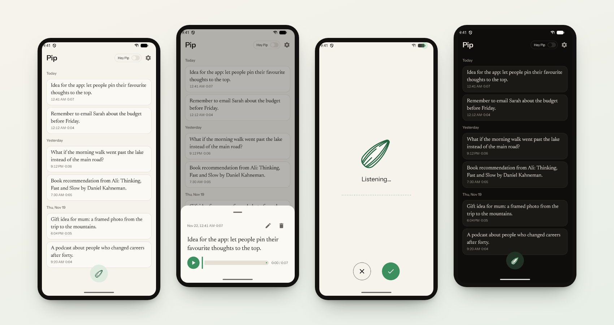
</p>

Pip has one job: catch an idea the moment it appears. Say **"Hey Pip"**, tap the quick-settings tile, or tap the widget. A short chirp tells you to speak. When you stop, a second sound tells you it is saved. In the background, Pip turns the recording into text. It works with the screen off and the phone locked.

Everything runs on the phone. The app has no internet permission, so it could not upload your voice even if it wanted to.

## Features

- **Four ways to catch a thought.** The "Hey Pip" wake word (a small model trained on the author's own voice), a **quick-settings tile** that works from the lock screen, a **home-screen widget**, and the seed button in the app. They all start the same capture.
- **Never loses a thought.** The audio is written to disk first, then the database row. The "caught" sound plays only after both are safe. The transcript is derived data and can always be redone.
- **Writes it down offline.** A background job transcribes each note with Whisper base.en. Nothing waits for it: you can keep catching thoughts while it works.
- **Works with the screen off.** A foreground microphone service keeps the wake word listening in your pocket. It pauses itself during calls and when another app is using the mic, and restarts after a reboot.
- **A notebook, not a feed.** The Pocket lists your thoughts grouped by day, in a serif face because they are your words. Open one to read it, play the recording, edit the text, or delete it. Long-press to select and delete several at once.
- **Sound and touch.** Three short kalimba sounds for "go ahead", "got it" and "nothing heard". In silent mode they become haptic taps.
- **Light and dark.** Light by default, whatever the phone is set to. Dark mode is a switch in Settings and crossfades smoothly.
- **Private by construction.** No internet permission, no analytics, no cloud backup, no accounts.

## Screenshots

<table>
  <tr>
    <td align="center">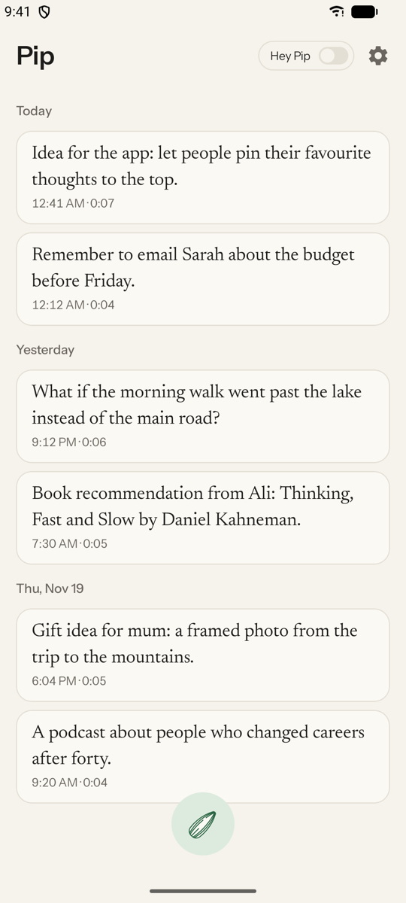<br><sub><b>Pocket</b><br>thoughts grouped by day</sub></td>
    <td align="center">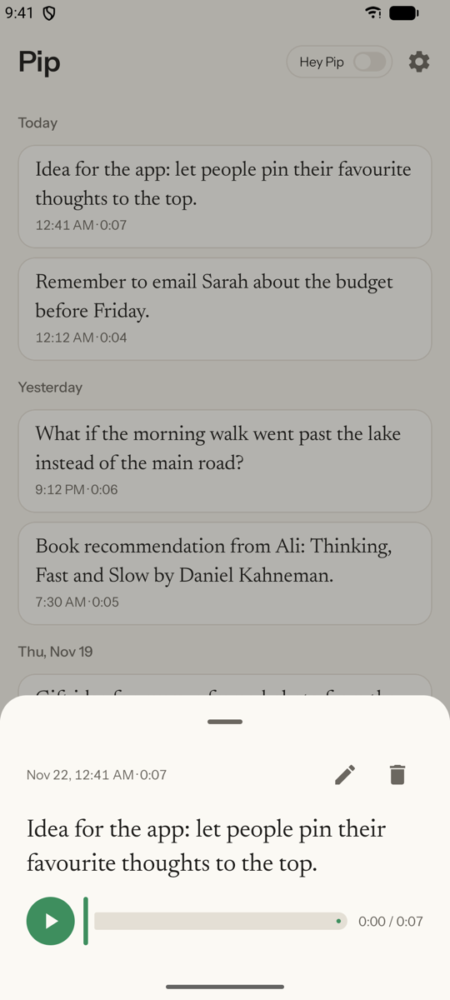<br><sub><b>A thought</b><br>read, play, edit, delete</sub></td>
    <td align="center">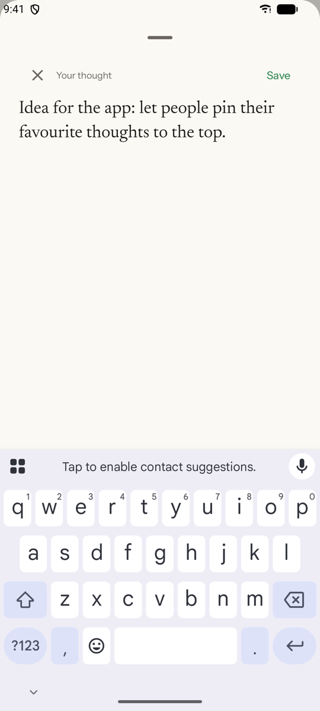<br><sub><b>Editing</b><br>the sheet grows to full height</sub></td>
    <td align="center">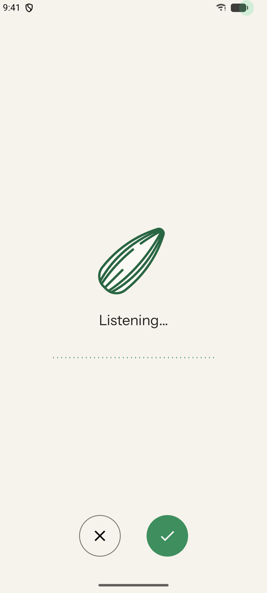<br><sub><b>Catching</b><br>tick saves, cross discards</sub></td>
  </tr>
  <tr>
    <td align="center">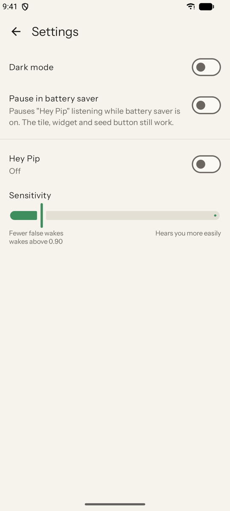<br><sub><b>Settings</b></sub></td>
    <td align="center">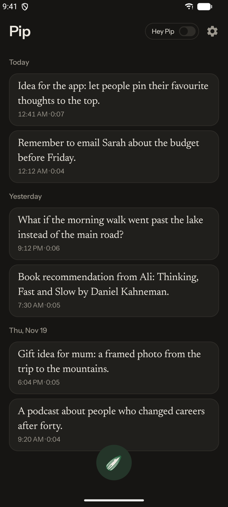<br><sub><b>Dark mode</b></sub></td>
    <td align="center">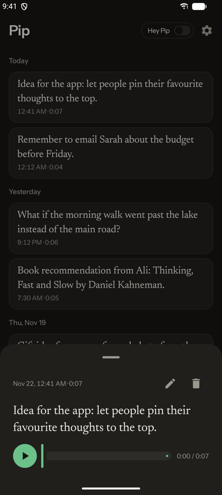<br><sub><b>A thought, dark</b></sub></td>
    <td align="center">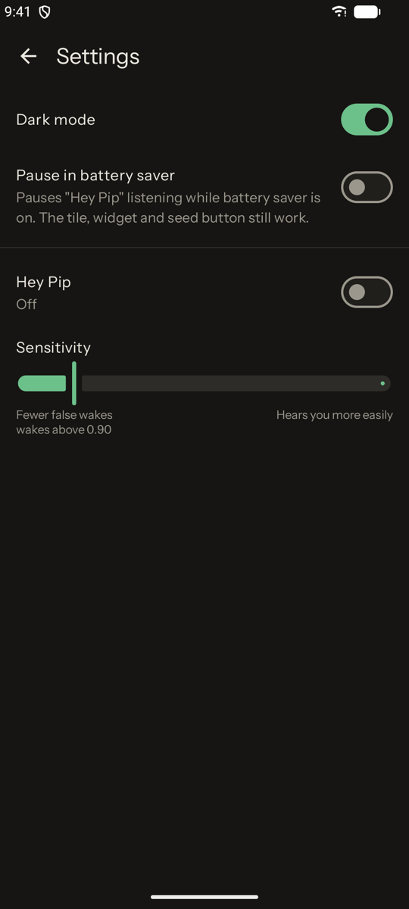<br><sub><b>Settings, dark</b></sub></td>
  </tr>
</table>

**The home-screen widget** has three parts: "Pip ›" opens the app, the "Hey Pip" switch turns wake-word listening on and off, and the big round button catches a thought. While it is catching, the button becomes a stop square that finishes and saves the note.

<table>
  <tr>
    <td align="center">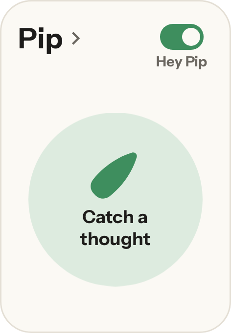<br><sub>Idle</sub></td>
    <td align="center">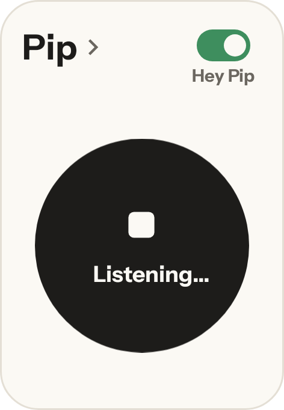<br><sub>Catching</sub></td>
    <td align="center">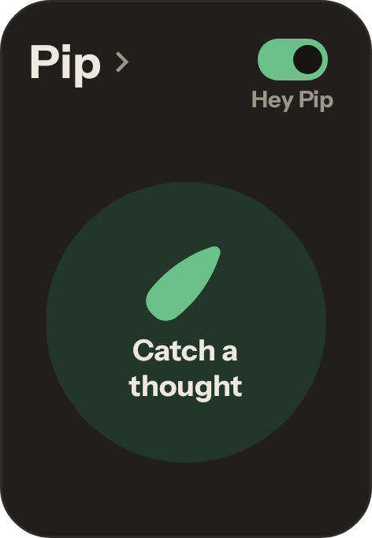<br><sub>Dark</sub></td>
    <td align="center">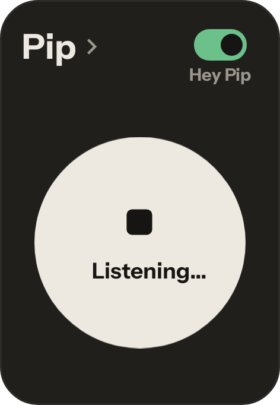<br><sub>Dark, catching</sub></td>
  </tr>
</table>

The widget images are the real widget layout rendered by an instrumented test ([`WidgetRenderTest`](app/src/androidTest/java/one/mindly/pip/WidgetRenderTest.kt)). The app screenshots use made-up notes.

## How it works

```
 "Hey Pip"  ─┐
 Pip tile   ─┤
 Widget     ─┼─►  record until 2 s of silence  ─►  WAV on disk ─► Room row ─► "caught" sound
 Seed button ┘     (voice activity detection)         (audio first)
                                                                      │
                          background job (WorkManager)  ◄─────────────┘
                          Whisper base.en, on the phone  ─►  text appears in the note
```

### The wake word

"Hey Pip" is detected by a model trained for this project, running on ONNX Runtime. It is built on openWakeWord's frozen front end, so only a small classifier had to be trained:

```
mic (16 kHz) ─► mel spectrogram ─► speech embedding ─► Pip classifier ─► P("Hey Pip")
                 frozen, ONNX       frozen, ONNX        trained here
                 every 80 ms        96 numbers          last 16 embeddings (~1.3 s)
```

- **Why not a pretrained keyword spotter?** The first version used one. On the author's phone it caught "Hey Pip" once in three minutes of trying: "Pip" is acoustically weak (soft consonants, one short vowel). That is what led to training a custom model.
- **Training data.** 46 recordings of the author saying "Hey Pip" through the phone's own mic, 9 minutes of normal speech as negatives, about 1,000 synthetic voices, and openWakeWord's large negative sets. Augmentation adds noise, room echo, speed changes and band-limiting. Training uses hard-negative mining, dropout, weight decay, and a time-split of the validation audio so the final test is untouched.
- **Results.** On held-out data: 10 of 11 clean clips caught at the default threshold (0.90), and 0.23 false wakes per hour on 4.3 hours of unrelated speech. These test sets are small; in everyday use the author reports it catches "Hey Pip" about 90 to 95% of the time, including in a pocket, with noise, and with the screen off.
- **Kotlin matches Python.** An instrumented test ([`WakeWordDetectorTest`](app/src/androidTest/java/one/mindly/pip/WakeWordDetectorTest.kt)) runs a reference recording through the Kotlin pipeline and compares it with the Python training code: embeddings agree within 3e-5 and scores within 2e-6.
- **A gotcha that cost a day.** The mel model scales its output relative to the loudest value in its input, so it must be run one 80 ms chunk at a time, never batched. Batching it in training made the features differ from what the app computes while streaming.
- **Cost.** About 30 ms of CPU per 80 ms of audio on a Galaxy A32, so the wake word is not free. It is only on when you switch it on.

### Stopping and saving

The same audio stream feeds a Silero voice-activity detector. A capture ends after 2 seconds of silence, or at a 2-minute cap. If nobody speaks within 4 seconds, nothing is saved and the "missed" sound plays. A 0.5 second pre-roll keeps the first word from being clipped. The rules live in [`CaptureSession`](app/src/main/java/one/mindly/pip/core/capture/CaptureSession.kt), a small pure state machine with unit tests.

### Transcription

Each saved note queues one unique [WorkManager](https://developer.android.com/jetpack/androidx/releases/work) job that works through every untranscribed note, oldest first, so only one copy of the model is ever in memory. A note is cut at its pauses into pieces of at most 20 seconds, each piece is transcribed with Whisper base.en through sherpa-onnx, and the text is tidied (a leftover "Hey Pip" at the start is dropped). On the author's phone it takes about 3 seconds per short note, plus about 6 seconds to load the model. If it ever fails, the note stays safe and the sheet offers "Try again".

### Triggers from outside the app

Android only lets a foreground service use the microphone if it was started while the app is visible. The tile and the widget therefore open a tiny invisible activity ([`QuickActionActivity`](app/src/main/java/one/mindly/pip/quick/QuickActionActivity.kt)) that starts the service, waits until the engine is capturing, and closes. It is allowed to show over the lock screen, so the tile works without unlocking.

### Storage

A [Room](https://developer.android.com/training/data-storage/room) database holds one row per thought, with a stable UUID. The recordings are WAV files in the app's private storage. The schema is exported, and migrations are never destructive.

## Tech stack

| | |
|---|---|
| Language and UI | Kotlin 2.2, Jetpack Compose, Material 3 |
| Build | Gradle (Kotlin DSL, version catalog), Android Gradle Plugin 9.5, KSP |
| Android | minSdk 29, targetSdk 37, foreground service (microphone), quick-settings tile, app widget (RemoteViews), WorkManager 2.11, Room 2.8 |
| On-device ML | ONNX Runtime 1.28 for the wake word, sherpa-onnx 2.0 for voice activity detection and transcription |
| Models | openWakeWord front end (mel + embedding), the Pip classifier, Silero VAD, Whisper base.en (int8) |
| Training | Python, PyTorch 2.8, onnxruntime, numpy |
| Fonts | Newsreader and Instrument Sans, bundled, so they work offline |

About 3,900 lines of Kotlin in the app, 500 in the tests, and 1,200 of Python for training and tools.

## Project layout

```
app/src/main/java/one/mindly/pip/
├── PipApp.kt              app-wide singletons (manual dependency injection)
├── MainActivity.kt        permissions; Pocket, Settings, note sheet, capture overlay
├── core/                  no Android UI imports
│   ├── audio/             microphone, WAV reading and writing, playback
│   ├── wakeword/          the "Hey Pip" detector and its sensitivity mapping
│   ├── vad/               speech detection
│   ├── capture/           the listening loop and the pure capture rules
│   ├── feedback/          sounds and haptics
│   ├── storage/           Room database and repository
│   ├── processing/        the background transcription job
│   ├── transcription/     speech-to-text and text clean-up
│   └── settings/          preferences as a StateFlow
├── service/               the foreground service, restart after reboot
├── quick/                 quick-settings tile, widget, the invisible trampoline activity
└── ui/                    home, note sheet, capture overlay, settings, theme layer

training/                  record, build a dataset, train and export the wake-word model
tools/                     cue sound generator, speech-model download script
docs/                      design guidelines and screenshots
CLAUDE.md                  long-form architecture notes, decisions and results
```

## Build and run

You need Android Studio (or JDK 17+ and the Android SDK) and an arm64 phone or emulator. Only `arm64-v8a` is packaged.

```bash
git clone https://github.com/Wahab3917/pip.git
cd pip
tools/fetch_speech_model.sh     # downloads the ~160 MB Whisper model (kept out of git)
./gradlew installDebug          # builds and installs on the connected device
```

Then open Pip, allow the microphone and notifications, and tap the seed button. To use the other triggers:

1. **Tile.** Swipe down, tap the pencil, and drag **Pip** into your active tiles.
2. **Widget.** Long-press the home screen, open Widgets, and add the 2×2 **Pip** widget.
3. **Hey Pip.** Switch it on in the app (top bar or Settings). On Samsung phones, also set Pip's battery use to **Unrestricted** so the system does not stop it in the background.

The APK is large (about 175 MB) because the speech model is bundled in it. Debug builds also log extra diagnostics and keep a rolling 10-second audio dump for tuning the wake word; release builds do not.

## Tests

```bash
./gradlew testDebugUnitTest                      # 16 JVM unit tests
ANDROID_SERIAL=<device> ./gradlew connectedDebugAndroidTest   # on a phone or emulator
```

| Test | What it checks |
|---|---|
| `CaptureSessionTest` | the rules for when a capture ends or is missed |
| `TranscriptCleanerTest` | removing a leftover "Hey Pip" and non-speech tags |
| `WavFileTest`, `WakeWordTuningTest` | the WAV format and the sensitivity mapping |
| `WakeWordDetectorTest` | Kotlin wake-word scores match the Python training code |
| `TranscriptionTest` | offline transcription, and the whole path from saving to a transcript |
| `QuickActionTest` | the widget's switch and a catch with "Hey Pip" off |
| `NoteEditingTest` | editing, deleting and bulk deleting on the real database |
| `WidgetRenderTest` | renders the widget at several sizes and checks the text fits its circle |

## Privacy and permissions

| Permission | Why |
|---|---|
| `RECORD_AUDIO` | to hear "Hey Pip" and record your note |
| `FOREGROUND_SERVICE`, `FOREGROUND_SERVICE_MICROPHONE` | to keep listening with the screen off |
| `POST_NOTIFICATIONS` | the small "Pip is listening" notification, with a "Pause for 1 hour" button |
| `RECEIVE_BOOT_COMPLETED` | to resume listening after a restart |
| `VIBRATE` | haptic cues in silent mode |

There is **no `INTERNET` permission**, no analytics, and no accounts. Backups and device-to-device transfer are switched off for the whole app. Recordings and text live only in the app's private storage.

## Training your own "Hey Pip"

The shipped classifier was trained on one person's voice, so it hears that voice best. [`training/`](training/README.md) has everything to train one on yours: it records clips through the phone's own microphone, builds a dataset, trains, and exports the model into the app. A few dozen recordings are enough, because the heavy lifting is done by the frozen speech-embedding model.

## Design

The look, sound and wording follow [`docs/design-guidelines.md`](docs/design-guidelines.md): warm paper, ink-black text, one seedling green, thoughts in a serif, and no shadows. Every colour, font, shape, animation timing, sound and string goes through a small theme layer (`ui/theme/`, `res/values/`, `res/raw/`), so restyling touches a handful of files and never the screens.

## Known limitations

- **English only.** The speech model is Whisper base.en.
- **A crash in the middle of a note loses that note.** The recording is held in memory (up to 2 minutes) and written at the end.
- **The wake word is tuned to one voice.** Expect to retrain it for yours.
- **Android 14 and newer cannot start the microphone service from boot.** After a restart Pip posts a "tap to resume" notification instead.
- **The widget is designed for the tall 2×2 shape** that Samsung's launcher uses. Launchers with square cells make the round button small and the label tight.
- **Samsung may stop Pip in the background** unless its battery setting is Unrestricted.

## Roadmap

Search, export, onboarding, a cheaper always-on wake word (only run the model when the audio sounds like speech), optionally deleting recordings after a number of days, and, later, sending thoughts to other apps.

## Credits

- **Logo:** "Sunflower Seed" by Amethyst Studio from [the Noun Project](https://thenounproject.com), licensed under [CC BY 3.0](https://creativecommons.org/licenses/by/3.0/). Recoloured and filled for Pip.
- **Wake-word front end:** [openWakeWord](https://github.com/dscripka/openWakeWord) (Apache-2.0).
- **Speech recognition and voice activity detection:** [sherpa-onnx](https://github.com/k2-fsa/sherpa-onnx) (Apache-2.0), with [Whisper](https://github.com/openai/whisper) (MIT) and [Silero VAD](https://github.com/snakers4/silero-vad) (MIT).
- **Runtime:** [ONNX Runtime](https://onnxruntime.ai/) (MIT).
- **Fonts:** [Newsreader](https://fonts.google.com/specimen/Newsreader) and [Instrument Sans](https://fonts.google.com/specimen/Instrument+Sans), SIL Open Font License (copies in [`licenses/`](licenses/)).

## License

[MIT](LICENSE). The models, libraries, fonts and logo above keep their own licenses.
